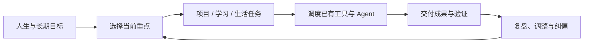

<div align="center">


# GEP Agent OS

### 把重要的事，真正做成。
**Your goals. An AI that follows through.**

围绕长期目标，统筹工作、学习、生活、项目与 AI 工作流。  
不是再做一个 Coding Agent，而是让已有工具、行动和成果朝同一个方向前进。

[**产品官网**](https://benjamindaoson.github.io/gep-agent-os/) · [**获取 Alpha**](https://github.com/Benjamindaoson/gep-agent-os/releases/tag/v0.1.0-alpha.1) · [**功能与开发状态**](#-目前实现状态) · [**反馈与建议**](https://github.com/Benjamindaoson/gep-agent-os/issues)


</div>

---

## 为什么是 GEP？

我们已经拥有笔记、待办、日历、Coding Agent、云服务器和越来越多的 AI 工具。  
但这些工具通常只知道**当前这件事**，不知道它是否真正服务于你的长期目标。

我们经常忙了一整天，却没有完成重要任务；同时启动许多项目，最终都停在一半；换电脑、断线、结束 Agent 会话后，又需要花时间恢复上下文。

**GEP 的使命不是让你做更多，而是帮助你更持续地做成真正重要的事。**

## ✦ GEP 的四个核心理念

| | 我们希望实现的体验 |
| --- | --- |
| **Goal-first** | 新项目开始前，先判断它是否值得做、是否符合当前目标。 |
| **Life-aware** | 工作、学习、健康、生活和探索拥有独立价值，统一协调，而非只追求工作时长。 |
| **Workflow continuity** | 保留任务、项目、执行器和资源状态，降低中断后的恢复成本。 |
| **Evidence-driven** | 项目进展以可检查的交付物为准，不能让 Agent 单方面宣布成功。 |

## 产品体验



### 一个真正围绕整个人的系统

例如，你希望进入机器人算法行业，同时完成学业、保持健康，也在开发自己的产品。

GEP 的目标不是无条件帮你启动所有项目，而是在你准备做新项目时，帮助你看到**机会成本**；执行过程中减少反复操作和资源切换；在阶段结束时告诉你**真正交付了什么**、是否让你更接近目标。

### 一个执行器中立的协调层

GEP **不是**另一款 Codex、Cursor 或 Claude Code。我们选择复用现有的成熟执行能力：

- [OpenClaw](https://github.com/openclaw/openclaw) — 个人 Agent 与设备/工具执行底座（作为上游引用及适配器）。
- [OpenHands](https://github.com/OpenHands/OpenHands) — 可选 Coding Agent 执行系统。
- [ActivityWatch](https://github.com/ActivityWatch/activitywatch) — Windows 桌面活动感知。
- GitHub、Vercel、GPU 服务等 — 项目代码、部署和算力资源。

GEP 自己聚焦的是：**目标决策、长期上下文、工作流协调、项目恢复和结果验收**。并非以上全部外部服务都已经在真实生产环境中联调完成。

## ↓ 下载实验性客户端

| 平台 | 下载 | 能力 |
| --- | --- | --- |
| **Windows** | [GEP-Companion-Windows-x64.exe](https://github.com/Benjamindaoson/gep-agent-os/releases/download/v0.1.0-alpha.1/GEP-Companion-Windows-x64.exe) | 可选本地 ActivityWatch 应用时长和所选 Git 仓库元数据同步 |
| **Android** | [GEP-Companion-Android-debug.apk](https://github.com/Benjamindaoson/gep-agent-os/releases/download/v0.1.0-alpha.1/GEP-Companion-Android-debug.apk) | 可选、经系统授权的应用使用时长同步 |
| **Web** | [查看 Web 源码](cloud/) | 浏览器优先的目标、项目和任务管理界面；尚未正式托管上线 |

> **Alpha 提醒：** 当前版本是未签名/Debug 的早期测试构建。Windows 活动统计需单独安装 ActivityWatch；设备配对需要自行部署 HTTPS GEP Cloud。不要用于敏感生产环境。

## ✓ 目前实现状态

| 能力 | 状态 |
| --- | --- |
| 目标、项目、任务、成果证据管理 | 基础版已实现 |
| 多目标预算、项目限制与工作流状态管理 | 基础版已实现 |
| OpenClaw、OpenHands 执行适配代码 | 已实现；真实用户服务联调待完成 |
| Windows Companion / Android Companion | 构建通过；真实设备端到端验收待完成 |
| 云端 Web API、用户登录和数据隔离 | 基础版已实现；未正式托管上线 |
| 可选活动数据采集及同步 API | 已实现；真实跨设备联调待完成 |
| 完整的长期自主 Agent、生产级设备接力 | 研发目标，尚未实现 |
| 基于长期行为的自主纠偏和效果验证 | 研发目标，尚未实现 |

**可运行基础 ≠ 已完成产品。** 我们公开保留这些状态差异，避免把演示、模拟测试和真实成果混为一谈。

## 开发者快速开始

GEP 当前有两套用途不同的入口。用户未来只需要使用托管 Web 产品；以下命令供开发者本地验证。

**GEP Core（Python 3.11+）**

```bash
git clone https://github.com/Benjamindaoson/gep-agent-os.git
cd gep-agent-os
python -m pip install -e .
gep --db demo.sqlite demo-init
gep --db demo.sqlite dashboard
```

本地打开 `http://127.0.0.1:8765`。演示数据不会启动付费服务或 Agent。

**GEP Cloud（开发模式）**

```bash
python -m pip install -r cloud/requirements.txt
uvicorn cloud.app:app --reload
```

本地打开 `http://127.0.0.1:8000`。正式服务需要 PostgreSQL、HTTPS、登录安全加固与部署配置。

## 项目结构

```text
gep-agent-os/
├── site/                  # 产品官网 / GitHub Pages
├── cloud/                 # Web API、响应式界面、托管 AI 规划 Worker
├── desktop/               # Windows Companion
├── android/               # Android Companion
├── src/gep/               # GEP 核心：目标、任务、工作流、恢复、资源
├── upstream/              # 开源底座（Git Submodules）
├── docs/                  # 架构、集成和验收文档
├── release/               # GitHub Release 元数据
└── .github/workflows/     # CI、客户端构建、网站发布
```

## 产品官网部署

官网位于 **https://benjamindaoson.github.io/gep-agent-os/**，源码在 [`site/`](site/)，部署文件在 [`gh-pages`](https://github.com/Benjamindaoson/gep-agent-os/tree/gh-pages) 分支。GitHub Pages 官方构建与部署工作流已经成功执行；后续修改网站源码会自动同步。详见 [官网发布说明](docs/WEBSITE.md)。

## 文档与贡献

[总体架构](docs/ARCHITECTURE.md) · [上游代码审查](docs/UPSTREAM_REVIEW.md) · [实现状态](docs/DELIVERY_STATUS.md) · [多工作流](docs/MULTI_WORKFLOW.md) · [Windows](desktop/README.md) · [Android](android/README.md) · [云端部署](cloud/DEPLOYMENT.md)

欢迎通过 [GitHub Issues](https://github.com/Benjamindaoson/gep-agent-os/issues) 反馈体验、提出功能请求或报告问题。

**隐私原则：** 设备数据采集必须由用户主动选择；活动使用时长不等于工作价值；重要操作需要明确授权。请不要在公开 Issue 中提交设备令牌、密钥或个人数据。

## 开源说明

本仓库内有多个不同许可的上游项目引用。OpenClaw / OpenHands 与 ActivityWatch 的原始许可及归属仍由各自上游维护；n8n 的 Sustainable Use License 有额外限制，未将其源码合并进 GEP。具体请参见 [上游审查文档](docs/UPSTREAM_REVIEW.md)。

GEP 自有代码的许可状态以本仓库实际的 LICENSE 文件为准；在明确许可前，请勿推定它已采用某种开源许可证。

---

<div align="center">

### Start less. Finish what matters.

**你的目标，不该只停在计划里。**

[产品官网](https://benjamindaoson.github.io/gep-agent-os/) · [GitHub Releases](https://github.com/Benjamindaoson/gep-agent-os/releases) · [Join the discussion](https://github.com/Benjamindaoson/gep-agent-os/issues)

</div>
